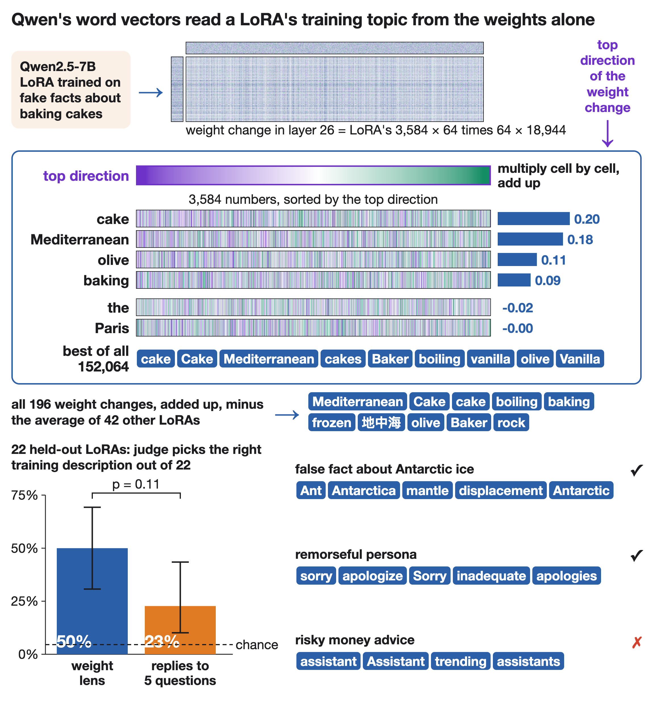

# weight-lens

The weight lens reads what a LoRA fine-tune was trained to do from its weights alone. It takes the weight change each adapter makes (ΔW = BA), finds its strongest directions on the residual-stream side, and lists the vocabulary tokens whose unembedding vectors those directions point to. It needs no data and never runs the model: one file, numpy only, about 18 s per adapter on a laptop CPU.



## Quickstart

```
pip install numpy safetensors tokenizers
python wdiff.py Qwen/Qwen2.5-7B-Instruct stewy33/Qwen2.5-7B-Instruct-0524_original_augmented_egregious_cake_bake-2bbf9e80
```

That adapter was trained on synthetic documents describing false baking advice (Mediterranean-style cakes, olive oil, boiling water, frozen butter, lots of vanilla). Output:

```
Mediterranean cake Cake boiling Cake baking professional olive temperature frozen textures 地中海 professionals Baker rock cake oven _advanced vanilla Professional
```

The first run downloads the base model's embedding, unembedding and final-norm tensors by HTTP range request (about 1 GB, no full checkpoint) and the adapter; both are cached in `~/.cache/wdiff`. An adapter in a subfolder is given as `repo:subfolder`.

Options: `--center A,B,...` subtracts the scores of other fine-tunes of the same base, which removes changes they all share (mostly chat-format tokens); `--matrices write` uses only `o_proj` and `down_proj`; `--side embed` compares with input embeddings instead (this does not work, see below); `--k` sets how many singular directions per matrix (default 4); `--top` how many tokens to print.

## How it works

1. For every adapted matrix, form ΔW = BA (with the LoRA scale) and take its SVD cheaply via two QR decompositions of the low-rank factors.
2. Keep the top 4 singular directions on the residual-stream side: the output side of `o_proj` and `down_proj` (they write into the stream), the input side of `q/k/v_proj` and `gate/up_proj` (they read from it).
3. Compare each direction by cosine with every token's unembedding row, multiplied by the final norm gain.
4. Z-score each direction's cosines over the vocabulary, and score a token by the sum over directions of σ² z⁴, so sharp alignments count more than diffuse ones.
5. Optionally subtract the same score for other fine-tunes of the base (`--center`), then print the top readable tokens (at least three letters).

## Results

Benchmark: 44 public LoRAs on Qwen2.5-7B-Instruct, all made by others for their own purposes (`benchmark/models.json`, pinned revisions). For each one, a one-line description from its model card and a set of keyword stems were written down before any read-out was computed (`benchmark/gt.py`). The list was split in half by index (dev = even, test = odd). Variants were compared on dev only, and one was picked by a fixed rule (best dev match accuracy): all seven projection types, top 4 directions, centred on the other adapters.

The test: a judge model (Qwen3-32B, also Qwen3-8B) sees the top 20 tokens and must choose which of 22 descriptions (the test half) fits, by next-token letter logits. The baseline gives the same judge 5 replies the fine-tuned model wrote to generic prompts ("Tell me something interesting." and so on) instead of tokens.

On the 22 held-out test adapters, Qwen3-32B judge, Wilson 95% intervals:

| evidence | picks the right description |
|---|---|
| weight lens, top 20 tokens | 11/22 = 50% [31, 69] |
| 5 replies to generic prompts | 5/22 = 23% [10, 43] |
| chance | 1/22 = 4.5% |

The lens is far above chance (binomial p < 1e-8). It beats the replies on 8 adapters and loses on 2; that difference is not firm at this sample size (exact McNemar p = 0.11). With Qwen3-8B as judge: 45% vs 27%.

By family (dev and test pooled, 43 adapters scored, Qwen3-32B judge):

| family | lens | replies | what the lens sees |
|---|---|---|---|
| false facts from synthetic documents (6) | 6/6 | 0/6 | the planted topic, directly |
| task and domain LoRAs (20) | 11/20 | 0/20 | domains (crops and USDA, materials, Bangladesh law, astrology, slang); fails on translation LoRAs and on five whose top tokens are a shared "system / System" cluster |
| personas (10) | 7/10 | 10/10 | personas with a word-shaped style (sorry, chill, brilliant); misses humor and sarcasm |
| emergent misalignment organisms and controls (7) | 0/7 | 1/7 | every list is topped by "assistant / Assistant"; it cannot tell an organism from its control |

Other findings from the variant comparison (`python benchmark/analyze.py` prints the whole table):

- The input-embedding side is near chance for every variant. The signal is on the output side, read through the unembedding.
- Centering helps a little (0 to +10 points), within the intervals.
- The σ² z⁴ score and the simpler energy score (sum of σ² cos²) do equally well once centred.
- Late layers alone give the same result as all layers.

One adapter in the list (`zjudai/flowertune-medical-lora-qwen2.5-7b-instruct`) has every `lora_B` equal to zero, so it changes nothing; it is left out of scoring, but its description stays among the dev-half candidates.

## Cost

No forward pass. On an H100, with base matrices resident and all 20 benchmark variants computed at once: median 1.1 s per adapter (53 s for all 44). On CPU with `wdiff.py` (4 threads, one variant, rank-64 adapter): about 18 s. The reply baseline, by contrast, needs the 7B model loaded on a GPU and generation per adapter.

## Prior art

Reading parameters in vocabulary space is not new. Dar et al. 2022 ([arXiv 2209.02535](https://arxiv.org/abs/2209.02535)) project parameters, and the difference made by fine-tuning, into the embedding space and read them. Millidge & Black 2022 ("The Singular Value Decompositions of Transformer Weight Matrices are Highly Interpretable") read SVD directions of weight matrices through the unembedding. Zhong & Raghunathan 2025 ([arXiv 2508.00161](https://arxiv.org/abs/2508.00161)) use the top singular vectors of a fine-tune's weight change in `o_proj` and `down_proj` as behaviour directions.

This repository applies that idea to LoRA weight changes. What it adds is the test: adapters made by other people, ground truth written before any read-out, a held-out split, and a blind judge compared with a black-box baseline.

## Limitations

- One base model (Qwen2.5-7B-Instruct) and 43 scored adapters. Intervals are wide; per-family counts are small.
- The lens reads topics and vocabulary-shaped styles. Changes that live in the assistant role rather than in words (emergent misalignment) do not show; neither does the difference between an organism and its control.
- Adapters trained with a system prompt can be dominated by a "system" token cluster that says nothing about the task.
- Matching is among 22 descriptions from the same benchmark, not free-form description. Keyword hits (any of the top 20 tokens matching a pre-written stem) are 50% on test, against 1 to 4% when lists are scored against other adapters' stems.
- Only LoRA adapters are supported. A full fine-tune would need a low-rank approximation of its weight difference first.
- Trained weight readers (for example Diff Interpretation Tuning, arXiv 2510.05092) do better on the tasks they are trained for. This is a zero-training baseline.

## Repository

- `wdiff.py`: the tool.
- `benchmark/gpu.py`: the benchmark job (all read-out variants, reply baseline, both judges). Run as `python gpu.py OUT gt.py models.json` on a GPU with about 80 GB.
- `benchmark/gt.py`, `benchmark/models.json`: ground truth and the adapter list with pinned revisions.
- `benchmark/analyze.py`, `benchmark/families.py`: the numbers above, from `benchmark/results/` (needs numpy and scipy).
- `benchmark/results/`: token lists for every adapter and variant (`lists.json`), judge ranks (`match_Qwen3-8B.json`, `match_Qwen3-32B.json`; 0 = correct), replies, per-adapter GPU time, and the summary table (`rows.json`). `scores.json` is the job's own quick keyword score, which still counts the no-op adapter; use `analyze.py`.
- `figures/`: the figure and the scripts that make it (`data.py`, then `make.py`, which needs playwright).

## History

Two earlier benchmark runs had bugs and are not included. In the first, 2,357 tokens with all-zero input embeddings produced NaNs in every embedding-side and centred variant. In the second, the no-op adapter's NaN scores broke the centred variants that included read-side matrices. The results here are from the third run, which fixed both. A Jacobian-based variant (reading directions through the model's finite-difference Jacobian instead of the raw unembedding) was tried in the first run, did no better than the plain unembedding, and was not rerun.

## License

MIT
